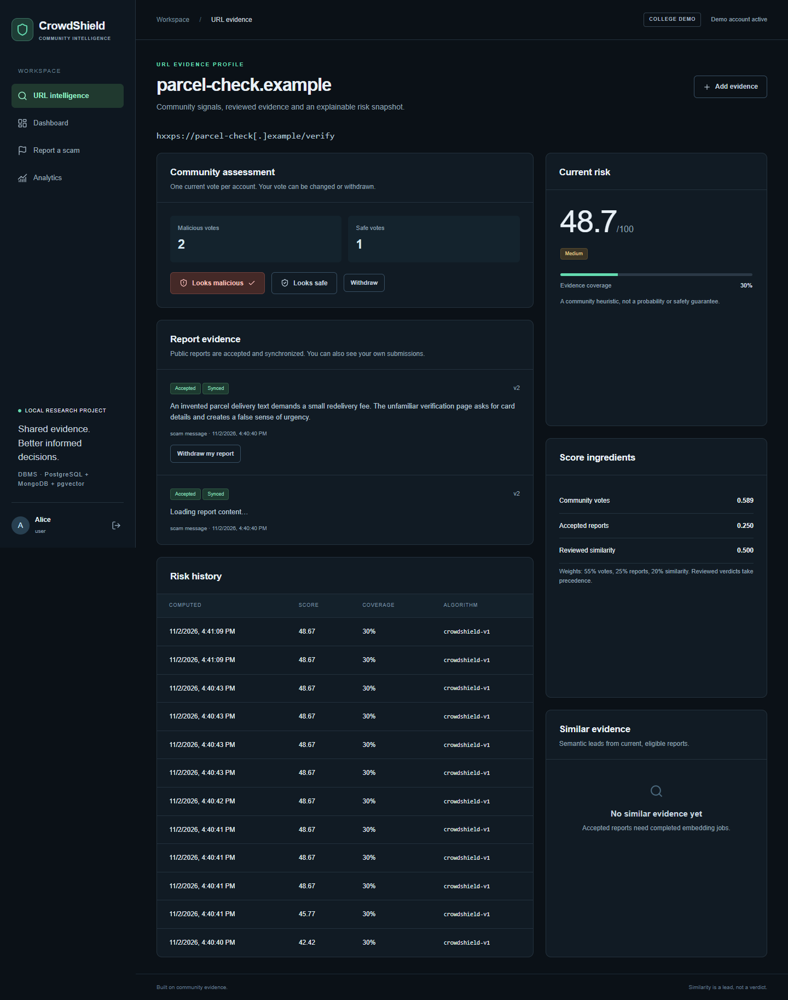

# CrowdShield

CrowdShield helps a community investigate suspicious links. Members report what they saw, moderators review the evidence, and anyone checking a URL can see the reasons behind its risk score. The app analyzes submitted text without visiting the reported site.

**[Download the project ZIP](https://github.com/chiranthanv/crowdshield/raw/refs/heads/main/CrowdShield.zip)** · [Run it locally](#run-it-locally)



## Follow a report

1. **Check a link.** Look up a URL to see its reporting history, risk components, and evidence coverage.
2. **Contribute evidence.** Describe what happened and vote on community reports. Moderators can review submissions before they become searchable evidence.
3. **Find related reports.** Search accepted reports by meaning. For example, try `parcel redelivery payment fee` against the seeded demo data.

## Run it locally

Install Node.js **22.13 or later** and start Docker Desktop with Compose. Extract the ZIP, open a terminal in the `CrowdShield` folder containing `package.json`, and run:

```sh
node scripts/install.mjs
npm run env:init
docker compose up -d --wait
npm run db:setup
npm run model:download
npm run db:seed
```

Start the web app with `npm run dev` and run `npm run worker` in a second terminal in the same folder. Open [localhost:3000](http://localhost:3000). The setup generates demo passwords in your local `.env`. The README inside the ZIP lists the demo accounts and includes a Docker-free setup.

## How it works

| Component | Responsibility |
| --- | --- |
| Next.js and TypeScript | URL lookup, report submission, moderation, analytics, and administration |
| PostgreSQL and pgvector | Relational records, score history, and similarity search over report embeddings |
| MongoDB | Versioned evidence documents synchronized from report changes |
| Node.js worker and MiniLM | Retry failed synchronization, embed accepted reports, and refresh risk scores |

## Explore the source

Inside the ZIP, start with `database/` for the schema and SQL examples, `docs/IMPLEMENTED_API.md` for the HTTP endpoints, and `tests/app/` for executable checks. To run the unit tests after installation, use `npm test`.

**Author** · [Chiranthan V](https://github.com/chiranthanv)
